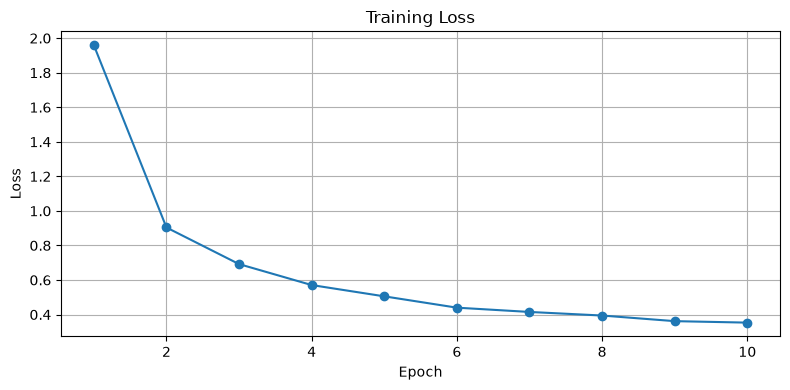
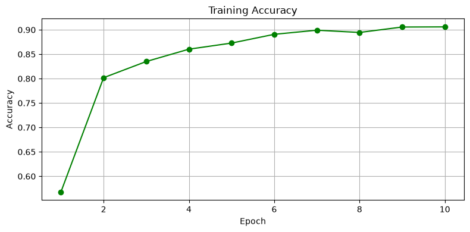
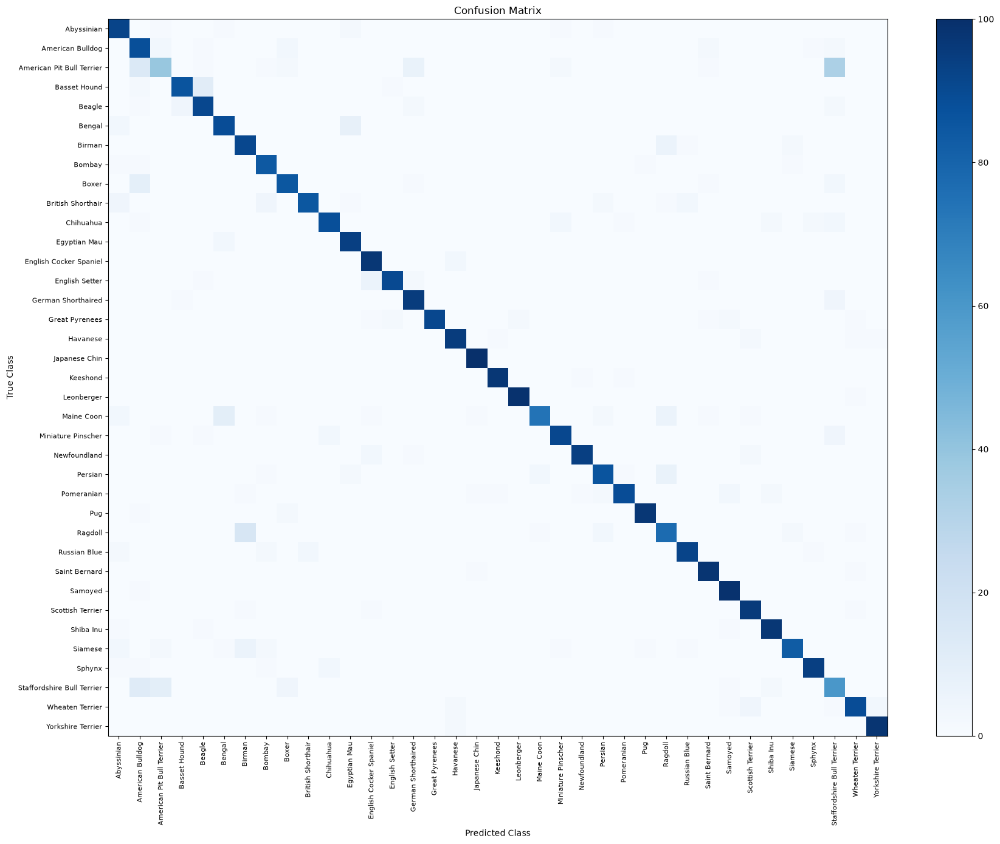
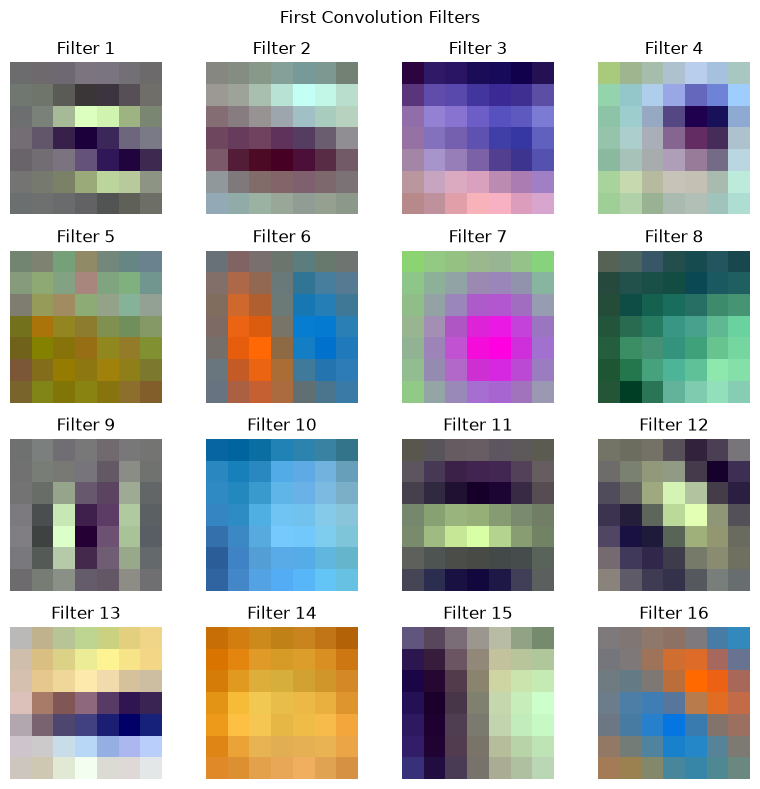
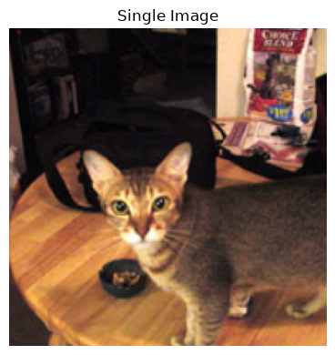
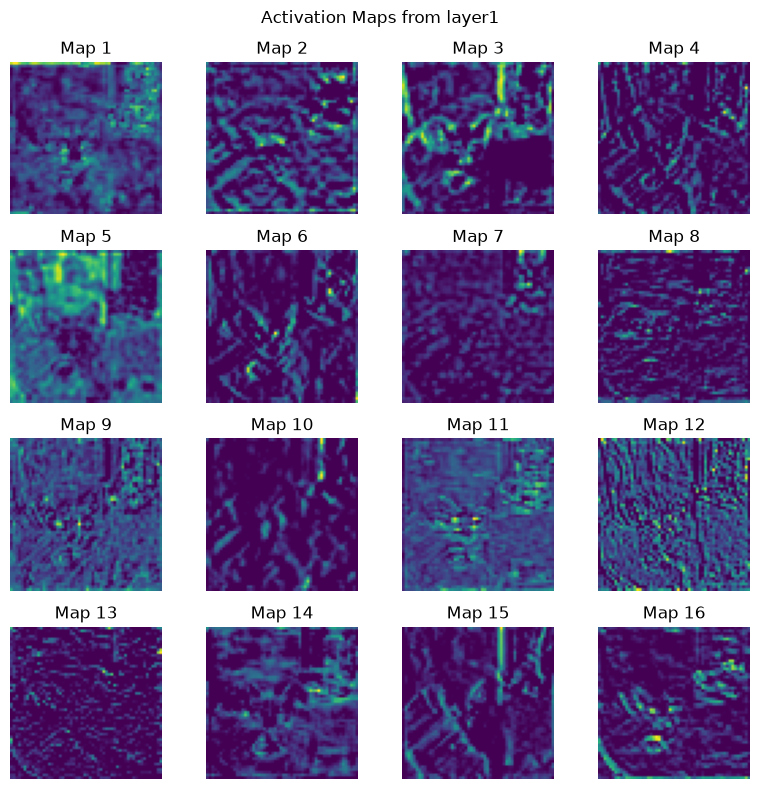

[Versión en Español](README_ES.md)

# Project 4 - Transfer Learning with ResNet18 (Oxford-IIIT Pet)

## Objective

This project applies transfer learning with a pretrained ResNet18 to classify images from the Oxford-IIIT Pet dataset.

The main goal was to reuse the visual knowledge learned on ImageNet and adapt it to a smaller, more specific dataset. That makes the training process faster, more stable, and much more practical than training a deep CNN from scratch.

---

# Why Transfer Learning?

Transfer learning is useful because models pretrained on large datasets already learn general visual features such as edges, textures, shapes, and object parts.

Instead of starting from random weights, we begin with a model that already knows how to extract useful image representations. Then we adapt it to a new task.

This is especially helpful when:

- The new dataset is smaller than ImageNet.
- Training a large network from scratch would take longer.
- We want better performance with less data.
- We want to reuse a strong architecture that already works well.

In practice, transfer learning often gives a very strong baseline with much less effort than full training.

---

# ImageNet and Pretrained Models

The model used in this notebook is pretrained on ImageNet, a very large dataset of natural images with 1000 classes.

ImageNet pretraining matters because the network has already learned generic low-level and mid-level features. Those features are not specific to ImageNet classes alone; they are useful for many vision tasks.

Using a pretrained model gives us:

- Better initialization than random weights.
- Faster convergence.
- Less risk of overfitting.
- A smaller training cost for the new task.

For this project, the pretrained backbone is ResNet18.

---

# ResNet18 Architecture

ResNet18 is a convolutional neural network built with residual blocks.

The key idea behind ResNet is the skip connection: instead of forcing each block to learn a complete transformation from scratch, the network can learn a residual mapping. That helps gradients flow more easily through deep models and makes optimization much more stable.

At a high level, ResNet18 is made of:

- An initial convolutional stem.
- Several residual stages.
- A global pooling layer.
- A final fully connected classification layer.

In this project, we do not train the full architecture from zero. We reuse the pretrained backbone and adapt only the parts that matter for the new dataset.

---

# Feature Extraction vs Fine-Tuning

This notebook uses both transfer learning strategies.

Feature extraction means freezing the pretrained backbone and training only a new classification head. The pretrained layers keep acting as a fixed feature extractor.

Fine-tuning goes one step further: we unfreeze some of the later layers so they can adapt to the new dataset.

The difference is important:

- Feature extraction is simpler and cheaper.
- Fine-tuning is more flexible and can improve accuracy when the new task is different from the original one.

In this project, most pretrained layers are frozen, but Layer4 and the final classification layer are trainable. That gives the model a balance between stability and adaptation.

---

# Dataset

The notebook uses the Oxford-IIIT Pet dataset.

It contains 37 classes corresponding to different cat and dog breeds. This makes it a good transfer learning task because it is related to natural-image classification, but it is still small enough to benefit from pretrained features.

Each image is resized and prepared to match the input expected by ResNet18:

- Input size: 224 × 224
- Color images with 3 channels
- Train and test splits loaded through TorchVision

---

# Image Preprocessing and Augmentation

The preprocessing pipeline is one of the most important parts of the project.

For training, the notebook uses augmentation to make the model more robust:

- RandomResizedCrop: randomly crops and resizes the image to 224 × 224.
- RandomHorizontalFlip: applies random horizontal flips.
- ToTensor: converts the image to a tensor.
- Normalize: uses ImageNet mean and standard deviation.

For evaluation, the notebook uses the official preprocessing returned by `weights.transforms()` from the pretrained ResNet18 weights.

ImageNet normalization is important because the pretrained model expects inputs with the same statistical scale it was trained on. If the normalization does not match, performance usually drops.

---

# Model Adaptation

The pretrained ResNet18 originally outputs 1000 classes for ImageNet.

Since this project solves a different problem, the final classification layer is replaced with a new linear layer that outputs 37 classes:

- Old head: 1000 ImageNet classes
- New head: 37 Oxford-IIIT Pet classes

This is the practical step that turns a general image classifier into a task-specific classifier.

After replacing the last layer, the notebook:

- Freezes all pretrained parameters.
- Unfreezes only Layer4.
- Unfreezes the final fully connected layer.

This means the early feature hierarchy stays stable while the later representation adapts to pet breeds.

---

# Training Setup

The project uses:

- CrossEntropyLoss for multi-class classification.
- Adam as the optimizer.
- CUDA when a GPU is available.

Using the GPU is important for transfer learning because even if only part of the network is trainable, forward passes through a ResNet are still computationally expensive on large image batches.

The training loop follows the standard PyTorch workflow:

1. Put the model in training mode with `model.train()`.
2. Move images and labels to the selected device.
3. Clear previous gradients with `optimizer.zero_grad()`.
4. Run the forward pass.
5. Compute the loss with `CrossEntropyLoss`.
6. Backpropagate with `loss.backward()`.
7. Update the trainable parameters with `optimizer.step()`.

That loop is simple, but it is the core of how fine-tuning works in practice.

---

# Evaluation

After training, the notebook evaluates the model on the test set using `model.eval()` and `torch.no_grad()`.

The main evaluation metric is accuracy, which measures the proportion of correctly classified images.

The notebook also includes richer evaluation tools:

- Top-5 predictions for a sample image.
- Confusion matrix over the test set.
- Visual inspection of a single prediction example.

Top-5 predictions are useful because they show whether the model is at least ranking plausible classes near the top, even when the top-1 prediction is wrong.

The confusion matrix helps identify which breeds are commonly confused with one another.

---

# Visualizing What the Model Learned

This project also inspects the internal representations learned by the network.

The notebook visualizes:

- The first convolution filters.
- Activation maps from Layer1 using a forward hook.

The first convolution filters often resemble simple edge and texture detectors. That is a reminder that early CNN layers usually capture very general visual patterns.

The activation maps show where the network responds most strongly in a sample image. They help explain how the model turns raw pixels into feature activations that later layers can combine into class predictions.

---

# Results

The training curves show that the loss decreases steadily and the accuracy improves during training.

The test-set confusion matrix shows that the model learns meaningful pet-breed representations, with most mistakes occurring between visually similar classes.

The notebook also includes example visualizations of the first convolution filters, a sample prediction, and the activation maps from the early layers:

Top-5 Predictions:
1. Abyssinian: 99.83%
2. Bengal: 0.07%
3. Miniature Pinscher: 0.04%
4. Russian Blue: 0.01%
5. Sphynx: 0.01%

Overall, the project shows that transfer learning reaches strong performance with a relatively small amount of training compared with learning a CNN from scratch.

---

# Main Conclusions

This project made the practical value of transfer learning very clear.

It showed that:

- Pretrained models already contain useful visual knowledge.
- Freezing most layers reduces training cost and stabilizes optimization.
- Fine-tuning the last convolutional block and classifier adapts the model to the target dataset.
- Data augmentation improves robustness.
- ImageNet normalization is required when working with ImageNet-pretrained weights.
- Visualization tools make the model easier to interpret.

The main takeaway is that transfer learning is a strong default choice for image classification tasks when the target dataset is not huge.

---

# Technologies

- Python
- PyTorch
- TorchVision
- Matplotlib
- Scikit-learn

---

##### Ramiro Alvarez
