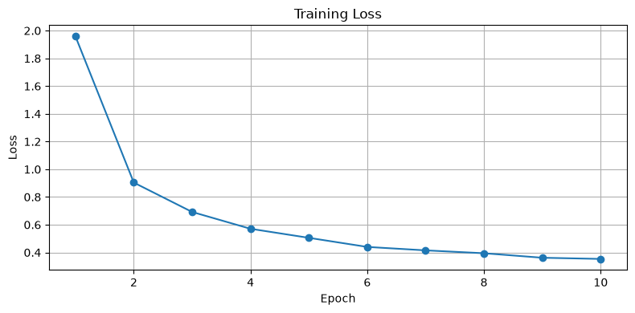
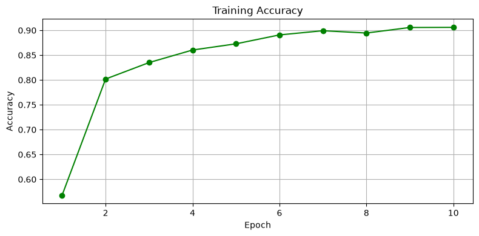
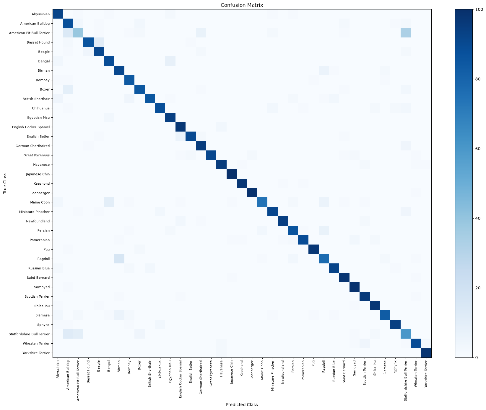
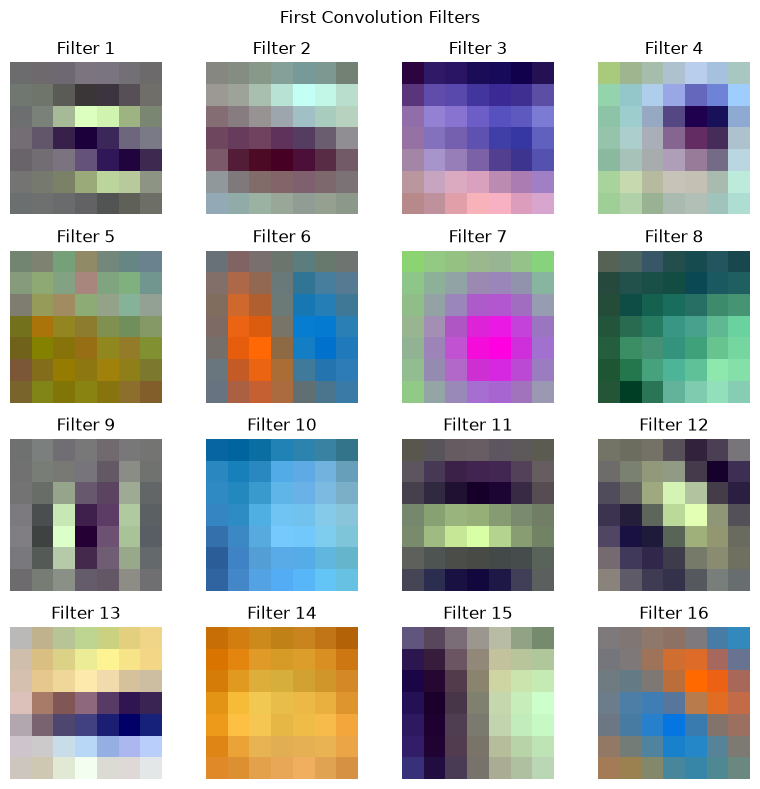
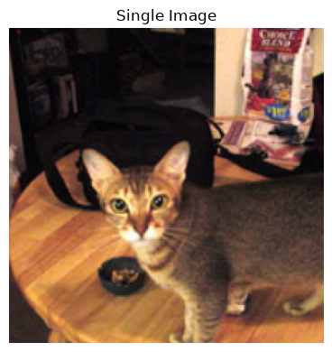
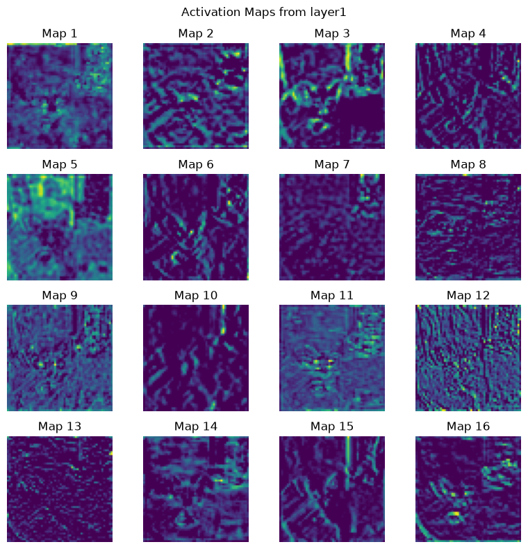

[English Version](README.md)

# Proyecto 4 - Transfer Learning con ResNet18 (Oxford-IIIT Pet)

## Objetivo

Este proyecto aplica transfer learning con una ResNet18 preentrenada para clasificar imágenes del dataset Oxford-IIIT Pet.

La idea principal fue reutilizar el conocimiento visual aprendido en ImageNet y adaptarlo a un conjunto de datos más pequeño y específico. Eso permite entrenar más rápido, con menos riesgo de overfitting y sin tener que aprender todo desde cero.

---

# ¿Por qué sirve el Transfer Learning?

El transfer learning es útil porque los modelos preentrenados en datasets grandes ya aprendieron características visuales generales como bordes, texturas, formas y partes de objetos.

En lugar de empezar con pesos aleatorios, se parte de un modelo que ya sabe extraer representaciones útiles de las imágenes y luego se ajusta al nuevo problema.

Esto es especialmente ventajoso cuando:

- El dataset nuevo es más chico que ImageNet.
- Entrenar una red grande desde cero sería más lento.
- Se quiere mejorar el rendimiento con menos datos.
- Se quiere aprovechar una arquitectura que ya funciona bien.

En la práctica, el transfer learning suele dar una base muy fuerte con mucho menos esfuerzo que un entrenamiento completo desde cero.

---

# ImageNet y modelos preentrenados

El modelo usado en este notebook fue preentrenado sobre ImageNet, un dataset enorme de imágenes naturales con 1000 clases.

Eso importa porque la red ya aprendió filtros genéricos de bajo y medio nivel. Esos filtros no sirven solo para las clases de ImageNet; también son útiles para muchas tareas de visión por computadora.

Usar un modelo preentrenado da varias ventajas:

- Mejor inicialización que los pesos aleatorios.
- Convergencia más rápida.
- Menor riesgo de overfitting.
- Menor costo de entrenamiento para el nuevo problema.

En este proyecto, la base preentrenada es ResNet18.

---

# Arquitectura de ResNet18

ResNet18 es una red convolucional construida con bloques residuales.

La idea clave de ResNet es la conexión de salto: en vez de obligar a cada bloque a aprender una transformación completa desde cero, la red aprende una corrección residual. Eso ayuda a que los gradientes circulen mejor y hace que el entrenamiento sea más estable.

A nivel general, ResNet18 está compuesta por:

- Un bloque convolucional inicial.
- Varias etapas residuales.
- Una capa de pooling global.
- Una capa final totalmente conectada para clasificación.

En este proyecto no se entrena toda la arquitectura desde cero. Se reutiliza el backbone preentrenado y se adapta solo lo necesario para la nueva tarea.

---

# Feature Extraction vs Fine-Tuning

En este notebook se usan las dos estrategias más comunes de transfer learning.

Feature extraction significa congelar el backbone preentrenado y entrenar solo una nueva cabeza de clasificación. Las capas preentrenadas se comportan como un extractor de características fijo.

Fine-tuning va un paso más allá: se descongelan algunas de las capas finales para que puedan adaptarse al nuevo dataset.

La diferencia es importante:

- Feature extraction es más simple y más barato.
- Fine-tuning es más flexible y puede mejorar la precisión cuando la tarea nueva difiere de la original.

En este proyecto, la mayor parte de las capas preentrenadas quedan congeladas, pero Layer4 y la capa final sí se entrenan. Eso equilibra estabilidad con capacidad de adaptación.

---

# Dataset

El notebook usa el dataset Oxford-IIIT Pet.

Contiene 37 clases correspondientes a distintas razas de gatos y perros. Es un buen caso para transfer learning porque se parece a una tarea de clasificación visual natural, pero sigue siendo lo bastante pequeño como para beneficiarse de un modelo preentrenado.

Cada imagen se prepara para el tamaño esperado por ResNet18:

- Tamaño de entrada: 224 × 224
- Imágenes RGB de 3 canales
- Separación en train y test usando TorchVision

---

# Preprocesamiento y data augmentation

El preprocesamiento es una de las partes más importantes del proyecto.

Para entrenamiento, el notebook usa augmentations para hacer el modelo más robusto:

- RandomResizedCrop: recorta y redimensiona aleatoriamente la imagen a 224 × 224.
- RandomHorizontalFlip: aplica volteo horizontal aleatorio.
- ToTensor: convierte la imagen a tensor.
- Normalize: usa la media y desviación estándar de ImageNet.

Para evaluación, el notebook usa el preprocesamiento oficial devuelto por `weights.transforms()` de los pesos preentrenados de ResNet18.

La normalización de ImageNet es importante porque el modelo preentrenado espera entradas con la misma escala estadística con la que fue entrenado originalmente. Si la normalización no coincide, el rendimiento suele bajar.

---

# Adaptación del modelo

La ResNet18 preentrenada original devuelve 1000 clases de ImageNet.

Como este proyecto resuelve un problema distinto, la última capa de clasificación se reemplaza por una nueva capa lineal que devuelve 37 clases:

- Cabeza original: 1000 clases de ImageNet
- Nueva cabeza: 37 clases del Oxford-IIIT Pet

Este es el paso práctico que convierte un clasificador general en un clasificador especializado en el nuevo dataset.

Después de reemplazar la última capa, el notebook:

- Congela todos los parámetros preentrenados.
- Descongela solo Layer4.
- Descongela la capa final totalmente conectada.

Eso hace que las capas tempranas conserven sus representaciones generales, mientras que las capas finales se adaptan a las razas de mascotas.

---

# Configuración de entrenamiento

El proyecto usa:

- CrossEntropyLoss para clasificación multiclase.
- Adam como optimizador.
- CUDA cuando hay GPU disponible.

Usar GPU es importante porque, aunque solo se entrenen algunas capas, los forward passes a través de una ResNet siguen siendo costosos cuando se trabaja con batches de imágenes grandes.

El ciclo de entrenamiento sigue el flujo estándar de PyTorch:

1. Poner el modelo en modo entrenamiento con `model.train()`.
2. Mover imágenes y etiquetas al dispositivo seleccionado.
3. Limpiar gradientes anteriores con `optimizer.zero_grad()`.
4. Ejecutar el forward pass.
5. Calcular la pérdida con `CrossEntropyLoss`.
6. Hacer backpropagation con `loss.backward()`.
7. Actualizar los parámetros entrenables con `optimizer.step()`.

Ese ciclo es simple, pero es la base de cómo funciona el fine-tuning en la práctica.

---

# Evaluación

Después del entrenamiento, el notebook evalúa el modelo sobre el test set usando `model.eval()` y `torch.no_grad()`.

La métrica principal es accuracy, que mide la proporción de imágenes clasificadas correctamente.

El notebook también incluye herramientas de evaluación más ricas:

- Top-5 predictions para una imagen de ejemplo.
- Matriz de confusión sobre el test set.
- Inspección visual de una predicción individual.

Las top-5 predictions son útiles porque muestran si el modelo al menos ubica clases plausibles entre las primeras opciones, incluso cuando la predicción top-1 no es correcta.

La matriz de confusión ayuda a ver qué razas se confunden con mayor frecuencia.

---

# Visualización de lo aprendido

El proyecto también inspecciona las representaciones internas que aprende la red.

El notebook visualiza:

- Los primeros filtros convolucionales.
- Los activation maps de Layer1 usando un forward hook.

Los primeros filtros convolucionales suelen parecer detectores simples de bordes y texturas. Eso recuerda que las primeras capas de una CNN aprenden patrones visuales muy generales.

Los activation maps muestran dónde responde con más fuerza la red en una imagen de ejemplo. Ayudan a entender cómo los píxeles crudos se convierten en activaciones útiles para las capas posteriores.

---

# Resultados

Las curvas de entrenamiento muestran que la pérdida baja de forma sostenida y la accuracy mejora durante el entrenamiento.

La matriz de confusión del test set muestra que el modelo aprende representaciones útiles de las razas, y que la mayoría de los errores ocurren entre clases visualmente similares.

El notebook también incluye visualizaciones de los primeros filtros convolucionales, un ejemplo de predicción y los mapas de activación de las primeras capas:

Top-5 Predictions:
1. Abyssinian: 99.83%
2. Bengal: 0.07%
3. Miniature Pinscher: 0.04%
4. Russian Blue: 0.01%
5. Sphynx: 0.01%

En conjunto, el proyecto muestra que el transfer learning logra un muy buen rendimiento con mucho menos entrenamiento que aprender una CNN desde cero.

---

# Conclusiones principales

Este proyecto dejó muy claro el valor práctico del transfer learning.

Mostró que:

- Los modelos preentrenados ya contienen conocimiento visual útil.
- Congelar la mayoría de las capas reduce el costo de entrenamiento y estabiliza la optimización.
- Fine-tuning de la última etapa convolucional y de la cabeza clasificadora adapta el modelo al dataset objetivo.
- El data augmentation mejora la robustez.
- La normalización de ImageNet es necesaria cuando se usan pesos preentrenados sobre ImageNet.
- Las visualizaciones hacen que el modelo sea más interpretable.

La conclusión principal es que el transfer learning es una excelente opción por defecto para tareas de clasificación de imágenes cuando el dataset objetivo no es enorme.

---

# Tecnologías

- Python
- PyTorch
- TorchVision
- Matplotlib
- Scikit-learn

---

##### Ramiro Alvarez
